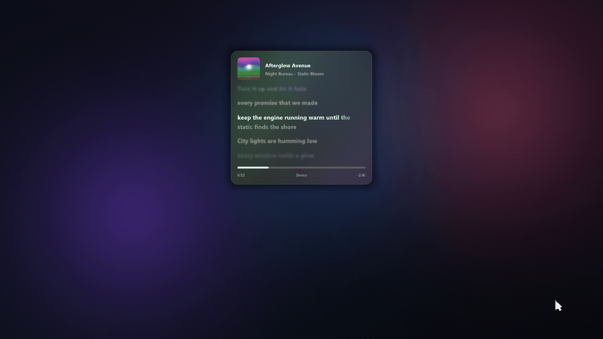
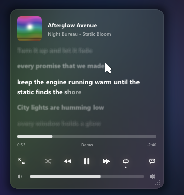
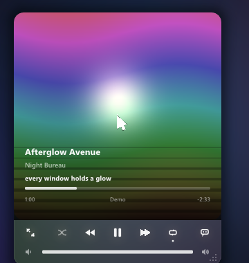
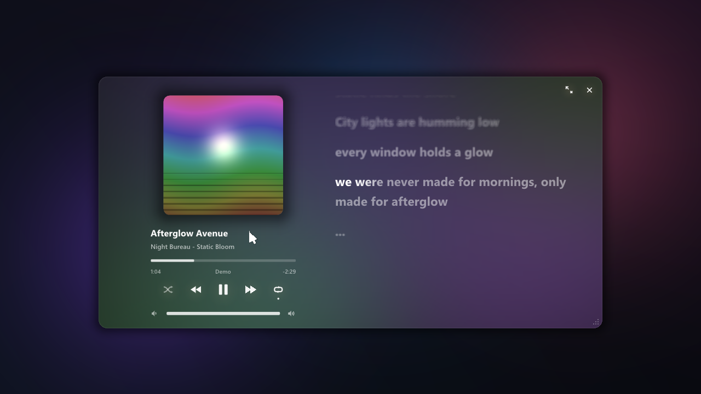

<h1 align="center">imgui-now-playing</h1>

<p align="center">
  <b>The Apple Music player, rebuilt as a Dear ImGui widget.</b><br>
  Synced karaoke lyrics, elastic sliders and a liquid background painted from the album cover.<br>
  Reads Spotify and any Windows media session. Drop-in, one draw call, any renderer.
</p>

<p align="center">
  <a href="#quick-start"></a>
  <a href="https://github.com/ocornut/imgui"></a>
  
  <a href="LICENSE"></a>
  <a href="https://github.com/InfernoTV/imgui-now-playing/stargazers"></a>
</p>

<p align="center">
  
</p>

<p align="center">
  <a href="#quick-start">Quick start</a> &nbsp;·&nbsp;
  <a href="#integrate-it">Integrate</a> &nbsp;·&nbsp;
  <a href="#api">API</a> &nbsp;·&nbsp;
  <a href="#how-it-works">How it works</a> &nbsp;·&nbsp;
  <a href="#faq">FAQ</a> &nbsp;·&nbsp;
  <a href="#roadmap">Roadmap</a>
</p>

---

**imgui-now-playing** is a "now playing" music widget for [Dear ImGui](https://github.com/ocornut/imgui) apps, overlays, game tools and launchers. It shows what Spotify (or any app that talks to the Windows media controls) is playing, lets you control it, and scrolls time-synced lyrics in sync with the song, with the motion and polish of a native music app.

It draws entirely through an `ImDrawList`, so it works on top of whatever ImGui backend you already have: DirectX 9/11/12, OpenGL, Vulkan, Metal, SDL. Icons are vector-drawn, so there is no icon font to ship.

## Features

- **Four modes with spring animations between them.** Compact card, cover card, resizable window, fullscreen. Size and position spring to the new layout while the content cross-fades.
- **Synced lyrics, karaoke style.** The active line lights up left to right as it is sung, long lines wrap instead of being cut, and inactive lines are dimmed and softly out of focus. Lyrics come from [LRCLIB](https://lrclib.net), no account or key needed.
- **Liquid background from the cover.** A smooth mesh gradient whose colours are sampled from the album art, drifting slowly like Apple Music's. Accent-colour and glass styles are built in.
- **Elastic sliders.** Timeline and volume use a C++ port of the [React Bits ElasticSlider](https://reactbits.dev) motion model: spring-driven fill, a rubber band when you drag past either end, thickness that grows on hover. Usable on its own for any slider.
- **Controls that feel physical.** Buttons lift and glow on hover, squash and spring back with a ripple when pressed. Shuffle and repeat show their state.
- **Real volume control.** Adjusts the playing app's own audio session (Spotify, a browser tab...), falling back to the system volume.
- **Hover-revealed chrome.** Controls and the volume slider fade in when the pointer is over the card and stay out of the way otherwise. Works as a passive HUD in games.
- **Drag, resize, persist.** Drag any mode around, resize the cards uniformly from the corner, resize the window freely. Everything lives in a `Layout` struct you can save.
- **Spotify first, everything else too.** Prefers Spotify when several players are open; otherwise follows the active session (Apple Music, Deezer, TIDAL, YouTube Music in Chrome or Edge, VLC, foobar2000...).
- **No dependencies beyond Dear ImGui.** C++/WinRT, Core Audio and WinHTTP come with the Windows SDK. JSON and image decoding are built in.

<table>
  <tr>
    <td align="center"><br><sub>Compact card</sub></td>
    <td align="center"><br><sub>Cover card</sub></td>
  </tr>
  <tr>
    <td colspan="2" align="center"><br><sub>Window: art column, transport, elastic volume, karaoke lyrics</sub></td>
  </tr>
</table>

> The previews use the built-in demo track (`--demo`): original lyrics and a generated cover, so no third-party music is shown.

## Quick start

Requirements: Windows 10 or 11, a C++20 compiler (MSVC 2022 tested), CMake 3.21+, Dear ImGui 1.92.

```bash
git clone https://github.com/InfernoTV/imgui-now-playing
cd imgui-now-playing
cmake -S . -B build -G "Visual Studio 17 2022" -A x64
cmake --build build --config Release
build\bin\Release\now_playing_demo.exe          # what you are listening to right now
build\bin\Release\now_playing_demo.exe --demo   # built-in demo track
```

The demo downloads Dear ImGui automatically. It opens a window with a small settings panel to switch modes, backgrounds, lyrics and scale.

## Integrate it

### 1. Add it to your build

With CMake, as a subdirectory or through FetchContent. If your project already defines an `imgui` target it is linked; otherwise set `NOW_PLAYING_IMGUI_DIR` to your Dear ImGui folder and the library only uses its headers (you keep compiling ImGui yourself, no second copy).

```cmake
include(FetchContent)
FetchContent_Declare(now_playing
    GIT_REPOSITORY https://github.com/InfernoTV/imgui-now-playing
    GIT_TAG        main)
FetchContent_MakeAvailable(now_playing)

target_link_libraries(your_app PRIVATE now_playing::now_playing)
```

Without CMake, compile the three files in `src/`, add `include/`, `src/` and `third_party/` to your include path, and link `windowsapp.lib`, `winhttp.lib` and `ole32.lib`. The project uses C++20.

### 2. Give it a way to create textures

The widget decodes the album cover itself and hands you RGBA pixels. Return whatever `ImTextureID` your renderer uses.

```cpp
// DirectX 11
ImTextureID create_texture(const unsigned char* rgba, int w, int h)
{
    D3D11_TEXTURE2D_DESC desc{ UINT(w), UINT(h), 1, 1, DXGI_FORMAT_R8G8B8A8_UNORM, { 1, 0 },
                               D3D11_USAGE_DEFAULT, D3D11_BIND_SHADER_RESOURCE };
    D3D11_SUBRESOURCE_DATA data{ rgba, UINT(w * 4), 0 };
    ID3D11Texture2D* tex = nullptr;
    ID3D11ShaderResourceView* srv = nullptr;
    device->CreateTexture2D(&desc, &data, &tex);
    device->CreateShaderResourceView(tex, nullptr, &srv);
    tex->Release();
    return (ImTextureID)srv;
}
void destroy_texture(ImTextureID id) { ((ID3D11ShaderResourceView*)id)->Release(); }
```

<details>
<summary>OpenGL 3</summary>

```cpp
ImTextureID create_texture(const unsigned char* rgba, int w, int h)
{
    GLuint tex = 0;
    glGenTextures(1, &tex);
    glBindTexture(GL_TEXTURE_2D, tex);
    glTexParameteri(GL_TEXTURE_2D, GL_TEXTURE_MIN_FILTER, GL_LINEAR);
    glTexParameteri(GL_TEXTURE_2D, GL_TEXTURE_MAG_FILTER, GL_LINEAR);
    glTexImage2D(GL_TEXTURE_2D, 0, GL_RGBA, w, h, 0, GL_RGBA, GL_UNSIGNED_BYTE, rgba);
    return (ImTextureID)(intptr_t)tex;
}
void destroy_texture(ImTextureID id) { GLuint tex = (GLuint)(intptr_t)id; glDeleteTextures(1, &tex); }
```
</details>

<details>
<summary>Dear ImGui 1.92 managed textures, Vulkan, DX12</summary>

Any backend works as long as the returned `ImTextureID` is something your `ImGui_ImplXXX_RenderDrawData` can bind. For Vulkan that is the `VkDescriptorSet` from `ImGui_ImplVulkan_AddTexture`; for DX12 the GPU descriptor handle of an SRV you created. Destroy it in `destroy_texture`.
</details>

### 3. Start the session and draw

```cpp
#include <now_playing/session.hpp>
#include <now_playing/widget.hpp>

now_playing::session::start();                       // once, at startup
now_playing::Widget player({ create_texture, destroy_texture });
now_playing::Layout layout;                          // save / load it to remember the player
now_playing::Style style;
style.title_font = bold_font;                        // optional, any ImFont*
style.body_font  = regular_font;

// every frame, after ImGui::NewFrame()
player.process_imgui_input(layout);
ImDrawList* dl = player.wants_foreground() ? ImGui::GetForegroundDrawList()
                                           : ImGui::GetBackgroundDrawList();
player.draw(dl, ImGui::GetIO().DisplaySize, layout, style, ImGui::GetIO().DeltaTime);

now_playing::session::stop();                        // at shutdown
```

That's the whole integration.

### Overlays and custom input

Game overlays often route input themselves. Feed the pointer directly instead of `process_imgui_input`, and turn interaction off when the overlay is click-through:

```cpp
player.set_interactive(menu_open);                   // false = passive HUD
player.mouse_move(pos, layout);                      // each returns true when it used the event
player.mouse_down(pos, layout);
player.mouse_up(pos, layout);
```

`rect_min()`, `rect_size()` and `rect_rounding()` give you the animated card rectangle, for example to place a Windows acrylic blur window behind it, or to block clicks to your own UI underneath.

## API

### `now_playing::Layout`: what the user changes

| Field | Default | Meaning |
| --- | --- | --- |
| `mode` | `Compact` | `Compact`, `Cover`, `Window` or `Fullscreen` |
| `position` | `{24, 24}` | Top-left of the compact / cover card |
| `scale` | `1.0` | Uniform card scale, `0.75` to `2.0` (corner handle) |
| `window_pos`, `window_size` | `{240,150}`, `{760,400}` | Window mode rectangle |
| `lyrics` | `true` | Show synced lyrics (also toggled from the card) |
| `cover` | `true` | Show the album cover in the compact card |

### `now_playing::Style`: how it looks

| Field | Default | Meaning |
| --- | --- | --- |
| `title_font`, `body_font` | current font | Bold and regular faces. With ImGui 1.92 any size renders crisp |
| `accent` | orange | Glow tint and the `Accent` background |
| `background` | `Liquid` | `Liquid` (cover colours), `Accent` or `Glass` (dark translucent) |
| `rounding` | `14` | Card corner radius at scale 1 |
| `background_alpha` | `0.97` | Opacity of the liquid / accent background |

### `now_playing::Widget`

| Method | Description |
| --- | --- |
| `draw(draw_list, display, layout, style, dt)` | Draw and animate one frame |
| `process_imgui_input(layout)` | Read the pointer from `ImGui::GetIO()` |
| `mouse_move / mouse_down / mouse_up(pos, layout)` | Feed the pointer yourself |
| `set_interactive(bool)` | Passive HUD mode: no hover reveal, input ignored |
| `rect_min / rect_size / rect_rounding` | Current animated rectangle |
| `contains(p)`, `hovered()`, `dragging()` | Hit testing helpers |
| `wants_foreground()` | True for window and fullscreen modes |
| `part_rect(Part, min, max)` | Where a control currently is (tests, tutorials, automation) |

### `now_playing::session`

| Function | Description |
| --- | --- |
| `start(Options)`, `stop()` | Background threads for the media session and lyrics |
| `snapshot(State&)` | Copy the latest state (title, artist, cover bytes, position, lyrics...) |
| `play_pause`, `next`, `previous`, `seek(seconds)` | Transport |
| `set_volume(0..1)`, `toggle_shuffle`, `cycle_repeat` | Volume and play modes |
| `set_lyrics_enabled(bool)`, `set_demo(bool)` | Lyrics fetching, built-in demo track |

`Options` lets you turn lyrics off, stop preferring Spotify, start in demo mode or set the HTTP user agent.

### `now_playing::elastic`

The slider physics are a separate header-only file with no other dependency than Dear ImGui. Drop it into any project:

```cpp
#include <now_playing/elastic.hpp>
namespace el = now_playing::elastic;

static el::Motion motion;
const el::Style style{ 6.0f, 12.0f, 40.0f };        // rest thickness, hover thickness, max stretch

el::set_value(motion, volume);                      // when the user is not dragging
motion.hovered = hovering_track;
el::update(motion, style, io.DeltaTime);
auto g = el::layout(motion, style, x, center_y, width);
el::draw(draw_list, g, IM_COL32(255, 255, 255, 60), IM_COL32(255, 255, 255, 240));

// pointer: el::press(motion) on down, el::drag(motion, style, (mx - x) / width, width) on move,
//          el::release(motion) on up. drag() returns the clamped value to commit.
```

## How it works

**Media session.** Windows exposes every player through the System Media Transport Controls (`GlobalSystemMediaTransportControlsSessionManager`). A background thread polls it with C++/WinRT, prefers the Spotify session, and extrapolates the playback position between updates so the timeline and lyrics stay smooth. Commands are queued to that thread so the UI never blocks.

**Volume.** The session's app id is matched against the processes owning audio sessions on the default output device (Core Audio `IAudioSessionManager2`), so the slider moves Spotify's or the browser's own volume. If nothing matches, it uses the endpoint volume.

**Lyrics.** On every new track a worker thread asks `lrclib.net` for synced lyrics by title, artist, album and duration, falling back to a search. `[mm:ss.xx]` timestamps are parsed into lines; the active line is found from the extrapolated position.

**Rendering.** Everything is plain `ImDrawList` geometry. The liquid background is a rounded-rectangle mesh coloured per vertex by five gaussian blobs drifting on Lissajous paths, seeded with colours averaged from regions of the cover. Shadows and glows are falloff meshes, the karaoke sweep ramps vertex alpha along each wrapped line, and inactive lines get a cheap ring blur.

**Motion.** The rectangle springs between modes (critically damped, sub-stepped at 240 Hz) while the two layouts cross-fade. Buttons use an underdamped spring for the press, so they squash and overshoot. The sliders run the ElasticSlider model: three damped springs, a sigmoid rubber band past the ends, thickness and squash derived from the stretch.

## FAQ

**Do I need a Spotify account, Premium or an API key?**
No. Nothing talks to Spotify's web API. The widget reads the same media session Windows uses for its volume flyout.

**Does it work with apps other than Spotify?**
Yes, with anything that integrates with Windows media controls. Spotify is just picked first when several are playing; set `Options::prefer_spotify = false` to always follow the active session.

**Some songs have no lyrics.**
LRCLIB is community-run. When a track has no synced lyrics the card says so. You can contribute lyrics on [lrclib.net](https://lrclib.net).

**Will it work in a game overlay?**
That is what it was built for. Call `set_interactive(false)` while the overlay is click-through: the card becomes a quiet HUD, and fullscreen mode steps down to the window so it never covers the game.

**Older Dear ImGui versions?**
It is developed and tested against 1.92. It only uses basic `ImDrawList` calls, so older versions may build, but 1.92's dynamic font atlas is what keeps text crisp at every size the widget scales to.

**Linux or macOS?**
Not yet: the backend is Windows-only (SMTC). The widget itself is portable; a `session` implementation for MPRIS (Linux) or MediaRemote (macOS) would plug straight in. Pull requests welcome.

## Roadmap

- **Rust port.** A native crate for `egui` and `imgui-rs` is next in line and starts as soon as this repository passes **500 stars**. Star it if you want it sooner.
- MPRIS backend for Linux.
- Word-level timing for lyrics that provide it (enhanced LRC).
- Queue and up-next preview in window mode.

## Credits

- [Dear ImGui](https://github.com/ocornut/imgui) by Omar Cornut.
- [LRCLIB](https://lrclib.net) for the free synced-lyrics API.
- Slider motion model after [ElasticSlider](https://reactbits.dev) from React Bits.
- [stb_image](https://github.com/nothings/stb) by Sean Barrett (public domain / MIT), compiled with internal linkage so it never clashes with yours.
- Layout and interaction inspired by Apple Music's player.

## License

[MIT](LICENSE). Use it in anything, commercial included.

<p align="center"><sub>If this saved you an afternoon, a star helps other ImGui developers find it.</sub></p>
